# AP3 · 光照与纹理场景（Lighting & Texturing）

> 课程：《计算机图形学应用实践》 · Assigned Project 3
> 教材：Angel & Shreiner, *Interactive Computer Graphics*, 8th ed.（Ch6 光照 / Ch7 纹理与反射 / Ch8 阴影）
> 技术栈：**原生 WebGL 2.0 + JavaScript**，使用教材配套 `Common/` 工具库风格（`webgl-utils.js` / `initShaders.js` / `MV.js`），**无构建步骤**，任意静态服务器直接运行。

一个黄昏庭院场景：手写 Phong 着色器（环境 + 漫反射 + 镜面三分量可独立开关并实时调参）、
位图纹理与切线空间法线贴图、立方体环境贴图反射、两遍渲染的阴影贴图（方向光 + 点光立方体阴影）、
以及颜色编码拾取（点击物体 → 高亮 → 面板切换为该物体材质）。三项选做全部实现。

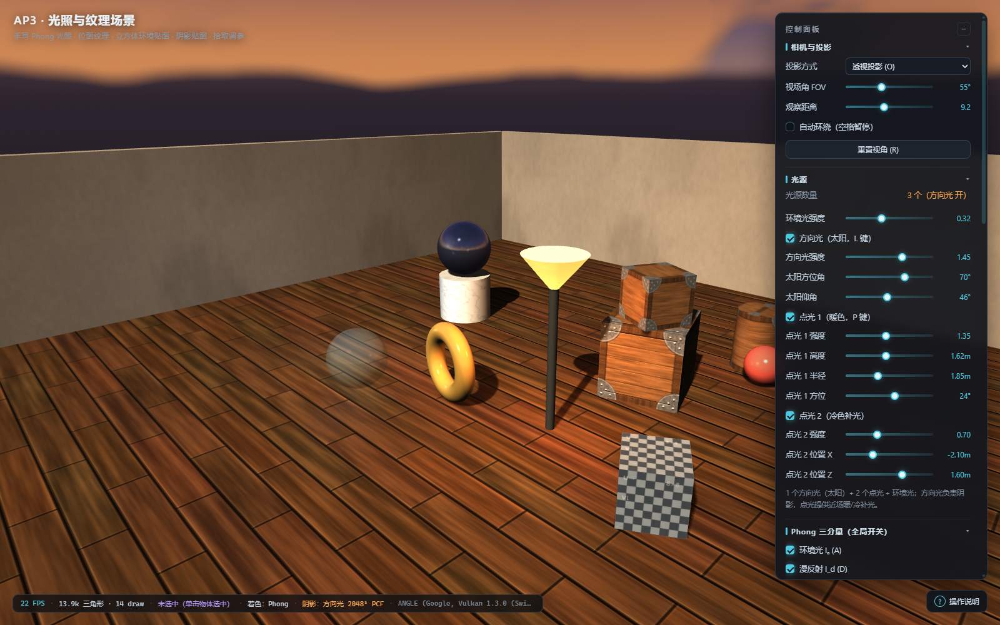

> **在线访问（GitHub Pages，任意电脑浏览器直接打开）**：<https://x1nghe159.github.io/AP3/>
> **源码仓库**：<https://github.com/X1ngHe159/AP3>

---

## 目录

1. [如何运行](#1-如何运行)
2. [项目结构](#2-项目结构)
3. [场景内容](#3-场景内容)
4. [功能实现详解](#4-功能实现详解)
   - [4.1 手写 Phong 光照 + 三分量开关](#41-手写-phong-光照--三分量开关)
   - [4.2 普通位图纹理与 UV 数据流](#42-普通位图纹理与-uv-数据流)
   - [4.3 立方体环境贴图反射](#43-立方体环境贴图反射)
   - [4.4 阴影贴图（两遍渲染）](#44-阴影贴图两遍渲染)
   - [4.5 拾取调参](#45-拾取调参)
5. [选做扩展](#5-选做扩展)
6. [交互说明](#6-交互说明)
7. [参数面板](#7-参数面板)
8. [自测与验证](#8-自测与验证)
9. [关键代码速览（抽问准备）](#9-关键代码速览抽问准备)
10. [部署到公网 URL](#10-部署到公网-url)
11. [已知限制](#11-已知限制)
12. [引用与致谢](#12-引用与致谢)

---

## 1. 如何运行

项目**没有构建步骤**，用任意静态服务器托管项目根目录即可（推荐 Node 或 Python 自带的）：

```bash
# Windows 最省事：双击 run.cmd（内部执行 node tools/serve.mjs）
# 方式一：项目自带的零依赖静态服务器（Node ≥ 18）
node tools/serve.mjs          # 打开 http://127.0.0.1:8134/

# 方式二：Python
python -m http.server 8134
```

然后浏览器访问 **http://127.0.0.1:8134/**（需支持 WebGL 2.0：Chrome / Edge / Firefox 新版本均可）。

### 为什么必须用静态服务器，不能直接双击 index.html？

页面用 ES Module（`<script type="module">`）加载 `src/main.js`，并且用 `Image` 加载 `assets/` 下的位图纹理。
在 `file://` 协议下浏览器会因同源策略拒绝这两件事（`CORS`），控制台会报模块加载失败 / 纹理被污染。
通过 http 访问就没有这个问题——这也是课程要求"静态服务器直接运行"的原因。

### 可选的 URL 参数（演示与截图用）

| 参数 | 作用 |
|---|---|
| `?preset=overview` | 直接套用一个预设机位，见 `src/state.js` 的 `PRESETS`（`combo-ambient`、`combo-diffuse`、`combo-specular`、`combo-all`、`shadow`、`shadow-debug`、`picking`、`reflection`、`uv-dataflow`、`extension-e1/e2/e3`、`wireframe`、`light-helpers`） |
| `?hideui=1` | 隐藏面板 / 标题 / 状态栏，得到纯净画面（对比图用） |

---

## 2. 项目结构

```
AP3/
├── index.html                 页面骨架（画布、面板容器、HUD、加载遮罩、帮助、错误提示）
├── run.cmd                    Windows 一键启动（双击：node tools/serve.mjs）
├── README.md                  本文档
├── css/style.css              深色玻璃拟态面板样式（覆盖 ui.js 生成的全部控件类）
├── lib/                       教材 Common 工具库（经典脚本，window.MV / window.initShaders）
│   ├── webgl-utils.js         画布初始化 / 着色器加载辅助
│   ├── initShaders.js         着色器编译链接（本项目优先使用它）
│   ├── MV.js                  向量矩阵库：translate/rotate/scale/mult/lookAt/perspective/ortho/normalMatrix
│   └── README-API.md          本项目实际可用的 MV.js API 清单
├── src/                       应用代码（ES Module，按"场景 / 着色器 / UI"分文件）
│   ├── config.js              ★ 场景集中配置：物体、材质默认值、纹理映射、光照辅助尺寸
│   ├── state.js               ★ 全局状态（唯一真值源）+ 预设 PRESETS + 点号路径读写
│   ├── ui-schema.js           参数面板的声明式定义（7 组 / 58 个控件）
│   ├── ui.js                  通用面板引擎：按 schema 生成 DOM 并双向绑定 state
│   ├── main.js                入口：初始化、输入事件、主循环、URL 参数、错误处理
│   ├── mat.js                 引擎内部数学（透视/正交/lookAt/逆矩阵/法线矩阵/TRS 组合）
│   ├── gl-utils.js            WebGL 封装：程序、VAO（三角形+线框索引）、纹理、FBO、拾取编码
│   ├── textures.js            位图纹理 / 立方体环境贴图加载（含兜底）
│   ├── camera.js              轨道相机 + 透视/正交切换 + 平移/缩放/自动环绕
│   ├── geometry.js            程序化几何体（cube/box/plane/sphere/cylinder/cone/torus）
│   ├── scene.js               装配 GPU 资源、光源世界坐标、阴影相机矩阵
│   ├── shaders.js             ★ 全部 GLSL：Phong 主着色器 / 深度 / 拾取 / 天空盒 / 描边 / 调试
│   ├── shadow.js              阴影贴图：方向光深度 FBO + 点光立方体深度 FBO
│   ├── picking.js             颜色编码拾取（离屏 ID 图 + readPixels）
│   └── renderer.js            ★ Pass 编排：阴影 → 天空盒 → 不透明 → 描边 → 透明 → 调试
├── assets/
│   ├── textures/              7 张 512² 程序化贴图 + 2 张切线空间法线贴图 + manifest.json
│   └── cubemap/               6 面 1024² 无缝黄昏天空盒（+X,-X,+Y,-Y,+Z,-Z）
├── docs/
│   ├── diagrams/              5 张中文原理示意图（UV 数据流 / 阴影两遍 / Phong 三分量 / 拾取 / 总体管线）
│   └── screenshots/           20 张演示截图（本文档全部引用）
└── tools/
    ├── serve.mjs              零依赖静态服务器
    ├── capture.mjs            无头浏览器（Edge/Chrome + CDP）批量截图
    ├── smoke.mjs              12 项功能自测（阴影 / 拾取 / 法线贴图 / 着色模型 / 键盘…）
    ├── test-geometry.mjs      几何体单元测试（191 项断言）
    ├── test-mv.mjs            MV.js 单元测试（96 项断言）
    ├── make_textures.py       贴图与天空盒的程序化生成脚本（可复现）
    └── make_diagrams.py       原理示意图生成脚本
```

**模块化原则**：`config.js` 只描述"场景里有什么"，`state.js` 只存"用户可调的参数"，
`shaders.js` 只有 GLSL，`renderer.js` 只编排 Pass，`ui.js` 只管面板 DOM。
想加一个物体 / 改一个材质 / 加一个参数，通常只改 `config.js` 或 `state.js` + `ui-schema.js`，渲染代码不用动。

---

## 3. 场景内容

黄昏庭院：14×14 木地板 + 两面 3.2 m 高的抹灰围墙，正面敞开可以看到天空盒。
场景共 **16 个物体**（远超 ≥5 的要求），全部由 `src/config.js` 集中描述：

| 物体 | 几何体 | 材质要点 |
|---|---|---|
| 木地板 | box 14×0.4×14 | `floor_wood` 贴图 + 法线贴图，UV 平铺 4×4 |
| 后墙 / 左墙 | box | `wall_plaster` 贴图，接收阴影 |
| 板条箱 / 小木箱 | box 1.15³ / 0.72³ | `crate_wood` 贴图 + 法线贴图（金属包角、铆钉凹凸） |
| 大理石台座 | cylinder | `marble` 贴图，高光 |
| 反射球 | sphere 0.52 | `reflect = 1.0`，立方体环境贴图反射 |
| 金环 | torus | 高光指数 150，强镜面 |
| UV 棋盘方块 | box 0.7³ | `tile_checker` 贴图（带 U/V 标注，讲 UV 数据流用） |
| 陶瓷球 | sphere 0.30 | 强镜面（演示高光指数） |
| 木桶 | cylinder | `crate_wood` 贴图，UV 平铺 2×1 |
| 玻璃球 | sphere 0.45 | `opacity = 0.30` → 走透明混合 Pass（选做 E2） |
| 灯柱 + 灯罩 | cylinder + cone | 灯罩 `emissive` 自发光，点光源 1 位于灯罩下方 |

**光源（3 类）**：

1. **环境光** `lights.ambient` —— 均匀底光，颜色与强度可调；
2. **方向光（太阳）** `lights.dir` —— 方位角 / 仰角 / 强度可调，**负责投射阴影**（2048² 阴影贴图）；
3. **两个点光源** `lights.point1`（暖色，挂在灯罩下方）/ `lights.point2`（冷色补光）—— 强度、高度、位置可调，
   带距离衰减，**点光源 1 可选做立方体阴影（E2）**。


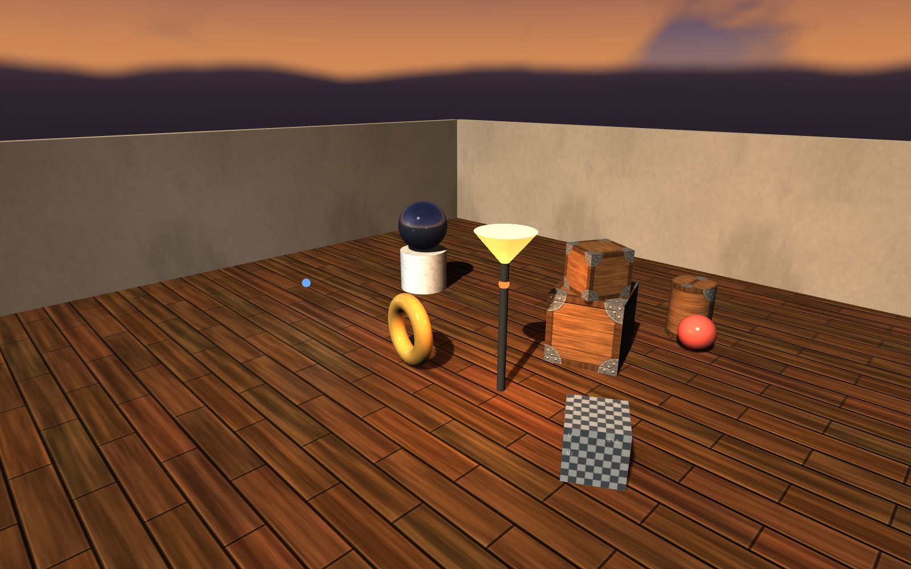

*（上图：面板「显示 → 光源辅助显示」打开后，可以看到太阳方向上的亮球和两个点光源位置。）*

**地面接收阴影**：地板 `receiveShadow = true`、自身不投射；所有立体物体 `castShadow = true`。

---

## 4. 功能实现详解

### 4.1 手写 Phong 光照 + 三分量开关

对应教材 Ch6。**顶点着色器只做坐标变换**，光照全部在**片元着色器**里逐像素计算（per-fragment Phong）：

```glsl
// 环境光项：k_a · I_ambient · albedo（均匀照明，没有立体感）
color += uAmbientScale * uAmbientStrength * uAmbientLight * albedo;

// 漫反射项：k_d · max(N·L, 0) · I_light · albedo（决定物体"亮暗面"）
// 镜面项：k_s · max(R·V, 0)^n · I_light（R = reflect(-L, N)）
// 其中 L = 指向光源的单位向量，V = 指向相机的单位向量，n = 高光指数
```

手写代码见 `src/shaders.js` 的 `MAIN_FS`（`lightContribution()` 函数同时实现了 Phong 与 Blinn–Phong 分支）。

**以 uniform 暴露的可调参数**（面板实时生效，无需重新编译着色器）：

| uniform | 含义 | 面板控件 |
|---|---|---|
| `uAmbientStrength` | 环境光系数 k_a | 选中物体材质 → 环境光强度 kₐ |
| `uDiffuseColor` | 漫反射颜色 k_d | 选中物体材质 → 漫反射颜色 |
| `uSpecularStrength` | 镜面强度 k_s | 选中物体材质 → 镜面强度 kₛ |
| `uShininess` | 高光指数 n（1–256） | 选中物体材质 → 高光指数 n |
| `uAmbientOn / uDiffuseOn / uSpecularOn` | 三分量独立开关 | Phong 三分量（全局开关）→ A / D / S |
| `uAmbientScale / uDiffuseScale / uSpecularScale` | 三分量倍率 | 三根倍率滑条 |

**四种组合对比截图**（同一机位、同一材质，只切换三个开关）：

| 只开环境光 | 只开漫反射 |
|---|---|
| 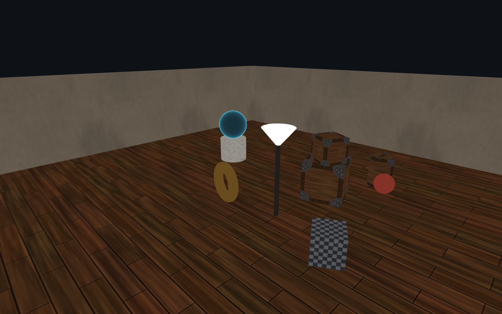 | 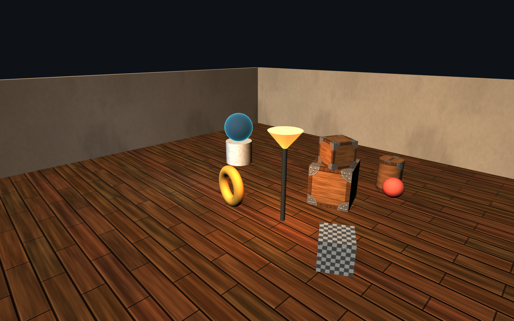 |
| **只开镜面** | **三分量全开** |
| 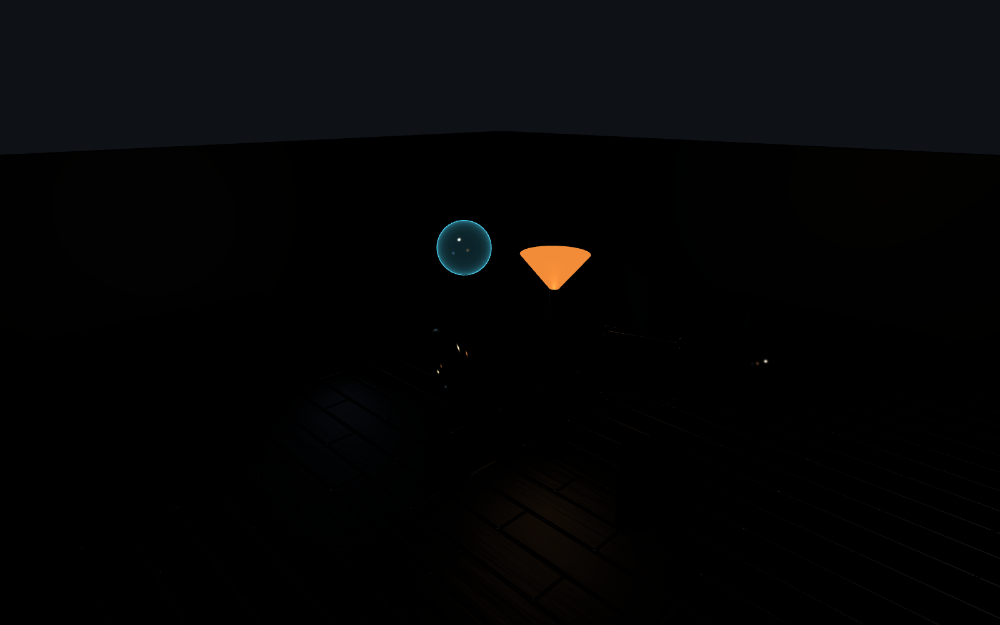 | 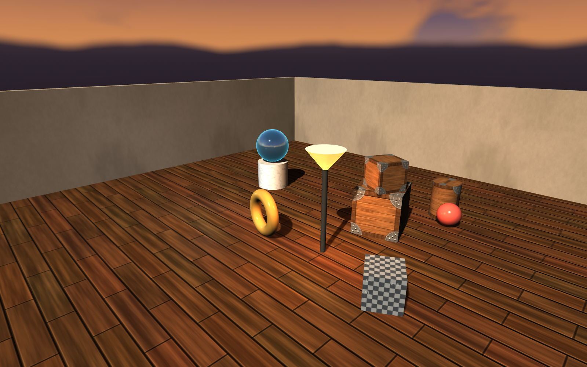 |

观察要点：

- **只开环境光**：所有面亮度相同，物体变成"剪影色块"，没有立体感——这就是环境光的特点。
  为了让这张图能看清轮廓，该预设把环境光倍率临时调到 6×（`?preset=combo-ambient` 里可见注释）。
- **只开漫反射**：出现明确的亮面 / 暗面，能看出球体、箱子的体积感，但表面"哑光"、没有高光。
- **只开镜面**：几乎全黑，只有高光点/高光带发亮——直观说明镜面项只贡献"光源的像"。
- **全开**：三者叠加得到最终效果；这也是默认渲染状态。

Phong 三分量的向量关系示意图见 `docs/diagrams/phong-components.png`。

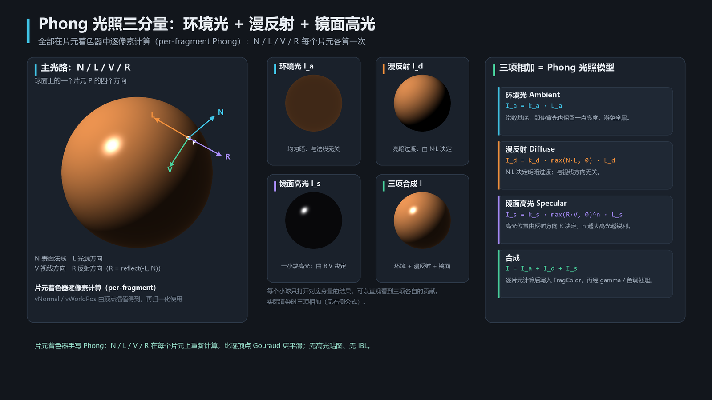

### 4.2 普通位图纹理与 UV 数据流

对应教材 Ch7.1–7.3。以 **UV 棋盘方块**（`tile_checker` 贴图，图上带 `U→` / `V↓` 标注）为例：

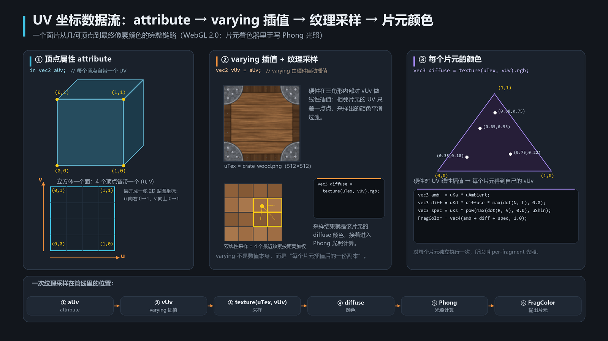

**数据流三步**（这也是抽问点）：

1. **顶点属性**：`src/geometry.js` 为每个顶点生成 `uv`（`aTexCoord`，location 2）。立方体每个面单独一组顶点，
   UV 各自展开到 `[0,1]²`，所以六个面都能正确贴图；
2. **光栅化插值**：顶点着色器把 `aTexCoord` 原样传给 `vUv`（`out vec2 vUv`），GPU 在三角形内部对 UV 做**线性插值**，
   片元拿到的是"该像素在纹理上的位置"；重复平铺由 `uUvScale`（如地板 4×4）在着色器里乘上去；
3. **片元采样**：`vec3 texColor = texture(uTexture, vUv * uUvScale).rgb;`
   纹理采样器做双线性过滤（放大，`LINEAR`）+ mipmap 三线性过滤（缩小，`LINEAR_MIPMAP_LINEAR`），
   采到的颜色再与 `k_d` 相乘（`uTexModulate`）进入 Phong 计算，最终输出为片元颜色。

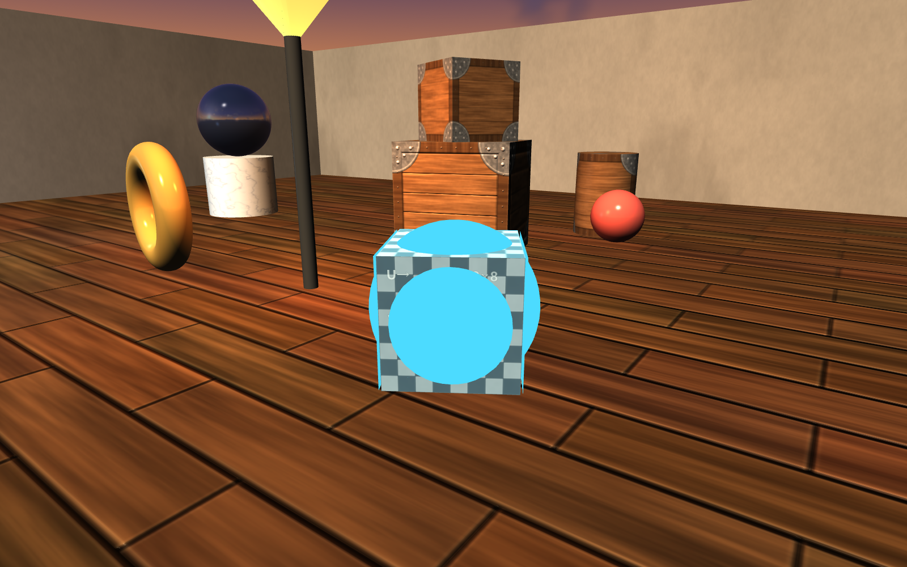

**纹理上传与"上下颠倒"问题**（`src/gl-utils.js` 的 `createTexture2D`）：

```js
gl.pixelStorei(gl.UNPACK_FLIP_Y_WEBGL, true);   // 图片原点在左上，WebGL 纹理原点在左下 → 翻转 Y
gl.texImage2D(gl.TEXTURE_2D, 0, gl.RGBA, gl.RGBA, gl.UNSIGNED_BYTE, image);
gl.pixelStorei(gl.UNPACK_FLIP_Y_WEBGL, false);
gl.texParameteri(gl.TEXTURE_2D, gl.TEXTURE_WRAP_S, gl.REPEAT);   // 平铺
gl.texParameteri(gl.TEXTURE_2D, gl.TEXTURE_MIN_FILTER, gl.LINEAR_MIPMAP_LINEAR);
gl.generateMipmap(gl.TEXTURE_2D);
```

图片文件的行 0 在**顶部**，而 WebGL 纹理坐标 v=0 在**底部**；若不翻转，贴图会上下颠倒。
本项目的几何体 UV 约定是"v=0 对应图片底边"，与 `UNPACK_FLIP_Y_WEBGL = true` 一致，
所以木地板、板条箱的文字/纹理方向都是正的。

> `UV 棋盘方块` 选择棋盘格是因为它能把"UV 拉伸 / 平铺次数 / 插值方向"直接看出来：
> 每格边界就是 UV = 0.125 的整数倍，格线若弯曲说明几何 UV 有问题。

### 4.3 立方体环境贴图反射

对应教材 Ch7.6（reflection mapping）。反射球材质 `reflect = 1.0`，片元着色器：

```glsl
vec3 I = normalize(vWorldPos - uCameraPos);   // 入射方向（视线，指向表面）
vec3 R = reflect(I, N);                        // 反射方向
vec3 env = texture(uEnvMap, R).rgb;            // 用反射方向采样立方体贴图
float fresnel = pow(1.0 - clamp(dot(N, V), 0.0, 1.0), 3.0);
color = mix(color, env, mixAmount);            // 菲涅耳加权混合
```

- 立方体贴图由 6 张 1024² 图片加载（顺序 `+X,-X,+Y,-Y,+Z,-Z`，`gl.TEXTURE_CUBE_MAP_POSITIVE_X + i`）；
- 6 张图是用**同一个连续天空函数 `sky(dir)`** 对每个像素反算方向后求值生成的，所以公共棱上天然无缝
  （`tools/make_textures.py`，实测 12 条公共棱平均色差 < 0.6/255）；
- 天空盒渲染用一个**全屏三角形** + `inverse(viewProj)` 反投影出每个像素的世界方向，再采样同一张 cubemap。

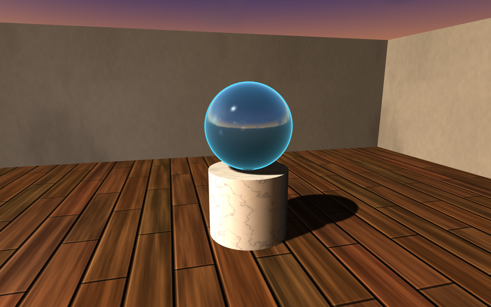

*球面把黄昏天空、太阳和地平线反射出来；菲涅耳加权让边缘反射更强，符合直觉。*

### 4.4 阴影贴图（两遍渲染）

对应教材 Ch8.8。**第一遍**：把相机放到光源位置，用正交投影渲染所有投射阴影的物体，
只写深度到一张 `2048 × 2048` 的 `DEPTH_COMPONENT24` 纹理（FBO 只有深度附件，
`gl.drawBuffers([gl.NONE])`）；**第二遍**：从相机视角正常渲染，片元先变换到光源裁剪空间，
用自己深度与贴图深度比较，被遮挡则只保留环境光。

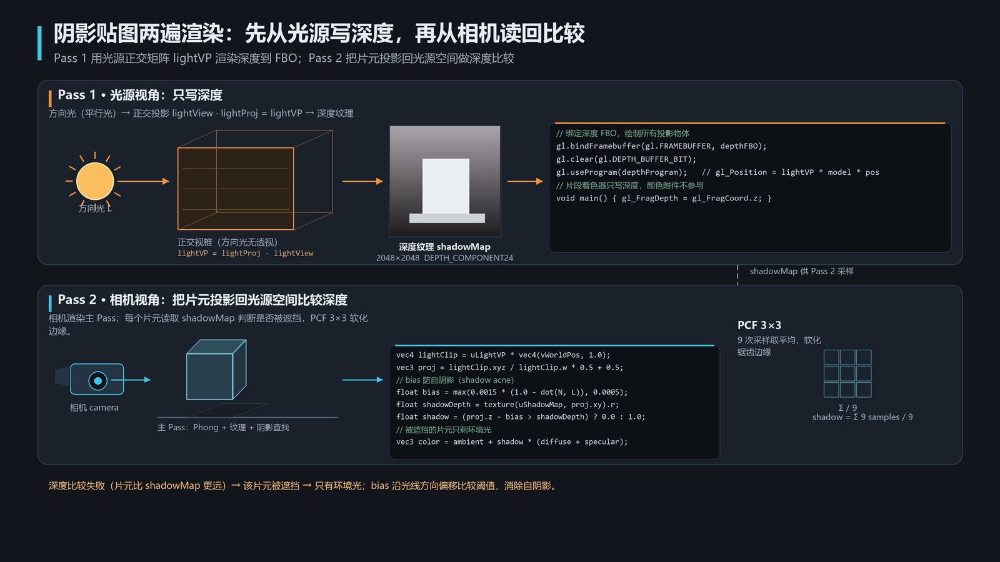

片元着色器里的核心比较（`directionalShadow()`）：

```glsl
vec3 proj = vLightSpacePos.xyz / vLightSpacePos.w;   // 透视除法 → NDC
proj = proj * 0.5 + 0.5;                              // → [0,1] 纹素坐标
if (proj.z > 1.0 || proj.x < 0 || proj.x > 1 || proj.y < 0 || proj.y > 1) return 1.0;  // 视锥外
float bias = max(uShadowBias * (1.0 - dot(N, L)), uShadowBias * 0.25);  // 斜率偏移，治自遮挡条纹
float current = proj.z - bias;
float d = texture(uShadowMap, proj.xy).r;            // 第一遍写入的最近深度
return (current > d) ? 0.0 : 1.0;                    // 0 = 在阴影里
```

**阴影参数全部可以在面板「阴影贴图」组里实时调**：

| 面板项 | 作用 |
|---|---|
| 开启阴影 (H) | 对比有无阴影 |
| 阴影光源 | 方向光阴影 / 点光立方体阴影（E2） |
| 阴影贴图分辨率 | 1024 / 2048 / 4096，切换会重建 FBO，观察锯齿 |
| 正交视锥半宽 | 覆盖范围越小 → 阴影越精细，但超出部分没有阴影 |
| 深度偏移 bias | 太小 → 阴影粉刺；太大 → 影子与物体"脱开"（peter-panning） |
| 3×3 PCF / 采样半径 | 软阴影 |
| 显示深度图小窗 | 右下角实时显示第一遍写出的深度纹理 |
| 调试可视化 | 把阴影因子 / 光源空间 UV / 贴图深度直接画成灰度图（答辩演示用） |

**bias 调参对比**（同一机位，左图 bias = 0.0035 正常，右图 bias = 0 且显示深度图小窗）：

| bias 合适 | bias = 0（阴影粉刺 + 深度图小窗） |
|---|---|
| 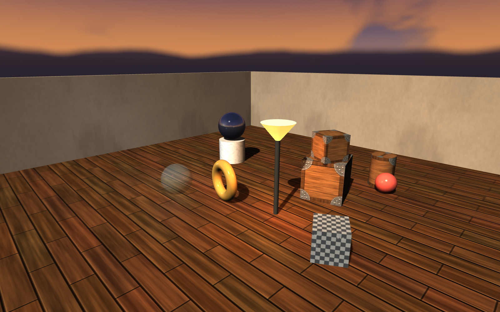 | 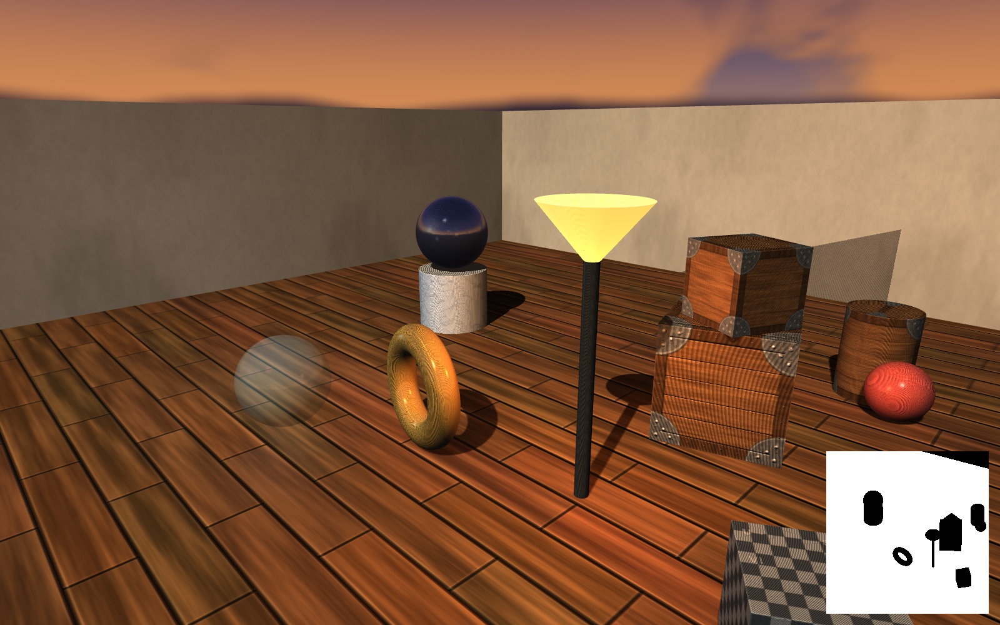 |

**阴影因子可视化**（白 = 受光，黑 = 处于阴影；对应 `display.debugMode = 1`）：

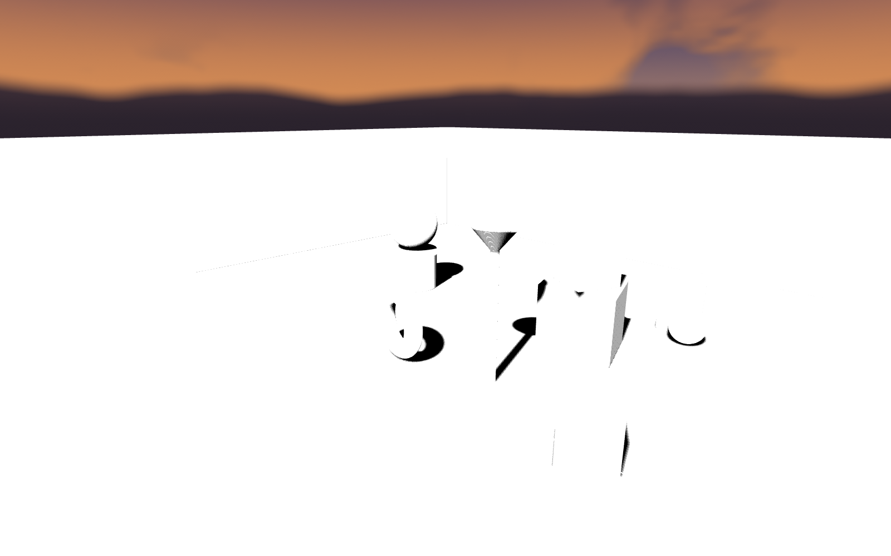

*可以看到物体背面与地面上的投影区域是黑色，其余受光区域是白色——这就是第二遍深度比较的结果。*

**点光源立方体阴影（选做 E2）**：把立方体深度纹理按 6 个方向各渲染一次（90° 视锥 × 6），
主 Pass 里用 `normalize(fragPos - lightPos)` 的方向去采样 cubemap，把透视深度线性化后与实际距离比较：

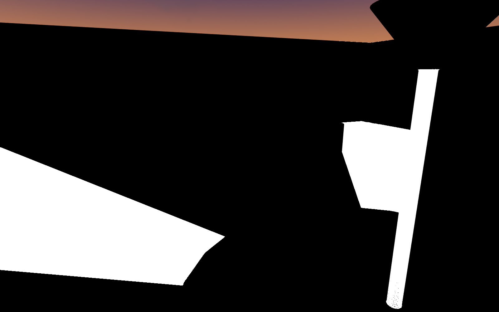

### 4.5 拾取调参

课程要求"选中即调参"，本项目用**颜色编码拾取**（GPU 版，教材 Ch3.9 拾取思想）：

1. 把场景重画一遍到离屏 FBO，但每个物体不画材质，而是画成自己的唯一 ID 颜色：
   `id = r + g·256 + b·65536`（`src/gl-utils.js` 的 `encodePickColor`）；
2. 鼠标点击时用 `gl.readPixels` 读回那一个像素，反解出 ID；
3. 命中物体 → 加描边 + 边缘光高亮 → 面板的「选中物体材质」组切换成该物体的材质参数。

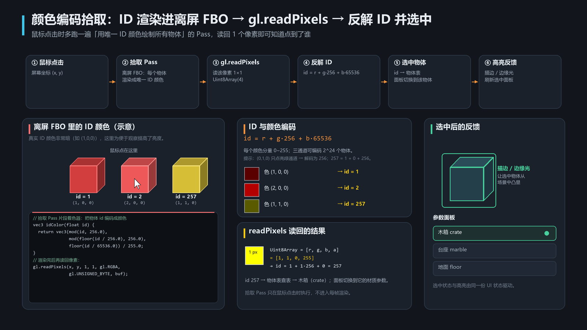

- **高亮**：两套叠加——① 片元着色器里 `uSelected` 分支加"边缘光 + 轻微变色"；
  ② 描边 Pass 把选中物体沿法线外扩约 2.2% 后再画一遍，**剔除正面**（`gl.cullFace(gl.FRONT)`）+
  不写深度，于是只在轮廓外露出一圈青色。半透明物体不画外扩描边（否则外扩网格会铺满整个球面），
  只保留边缘光。
- **面板联动**：`state.selectedId` 变化后 `refreshDynamicGroups()` 重建材质组，
  路径里的 `*` 被解析成当前物体 id（`materials.*.shininess` → `materials.crate.shininess`）；
- **点击空白处**取消选中；面板也有「取消选中」按钮。

| 拾取板条箱 | 选中反射球后的材质面板 |
|---|---|
| 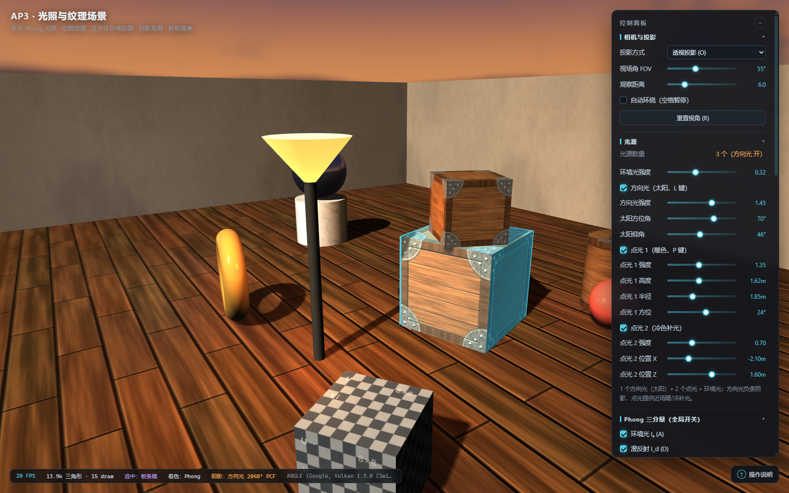 | 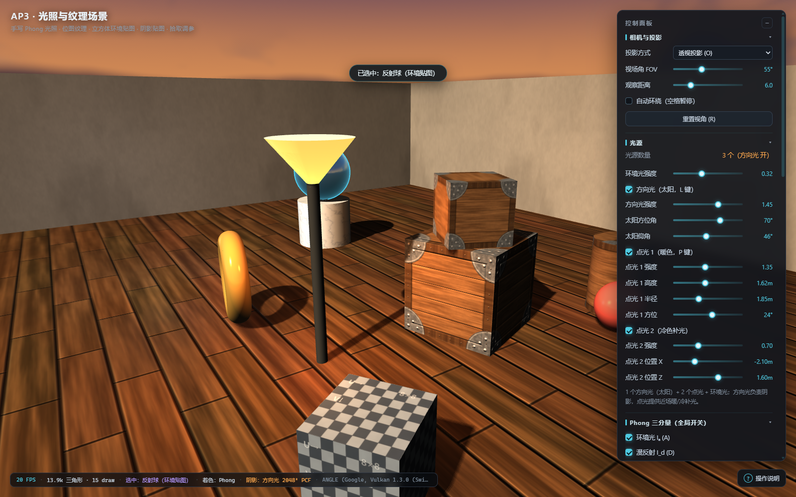 |

---

## 5. 选做扩展

### E1 · 法线贴图对比展示

切线空间法线贴图：`floor_wood_normal.png` / `crate_wood_normal.png` 由高度场求梯度生成
（编码 `rgb = n*0.5+0.5`，平坦处 `(128,128,255)`）。片元着色器用顶点切向量 T 与
`B = cross(N, T)` 构造切线空间，把采样到的法线变换回世界空间：

```glsl
vec3 T = normalize(vTangent - N * dot(N, vTangent));   // Gram-Schmidt 正交化
vec3 B = cross(N, T);
vec3 tn = texture(uNormalMap, vUv * uUvScale).xyz * 2.0 - 1.0;
tn.xy *= uNormalStrength;                                // 面板可调凸起强度
N = normalize(T * tn.x + B * tn.y + N * tn.z);
```

**左右分屏同场景对比**（左：关闭法线贴图，平滑顶点法线；右：开启，铆钉与板缝有明显受光变化）：

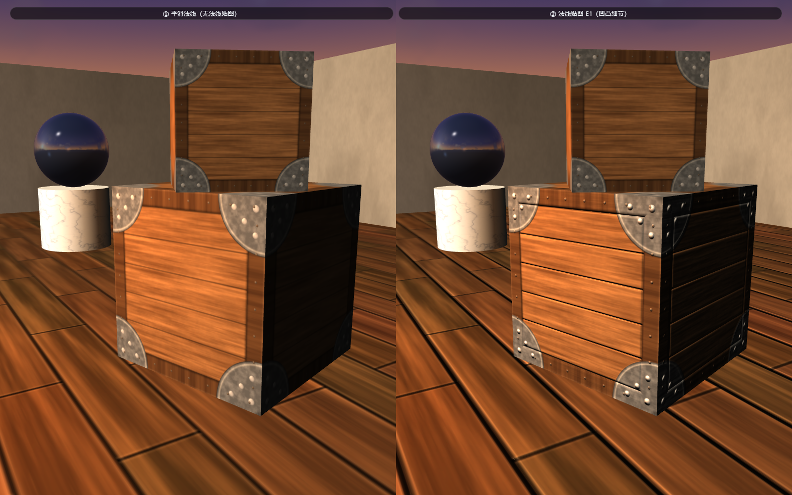

> 面板「纹理与环境贴图 → 法线贴图 (N)」可随时开关，`法线凸起强度` 滑条控制强度（0 = 贴图失效）。
> 切线手性说明：本项目的切线对 cube/box/plane 是右手系（`B = cross(N,T)`），
> 对 sphere/cylinder/cone/torus 是左手系；由于目前只有 box 类物体挂了法线贴图，当前实现正确。
> 若以后给曲面加法线贴图，需要 `B = -cross(N, T)`（详见 `src/geometry.js` 注释）。

### E2 · 透明混合 + 点光源立方体阴影

- **透明混合**：玻璃球 `opacity = 0.30`，渲染时进入单独的透明 Pass：`gl.enable(gl.BLEND)` +
  `SRC_ALPHA / ONE_MINUS_SRC_ALPHA`，按相机距离**由远到近**绘制，且**不写深度**（`depthMask(false)`），
  这样它后面的物体能正确透出来。面板「选中物体材质 → 不透明度」可实时调（拖到 1.0 就变成实心球）。
- **点光源阴影**：见 4.4 最后一段，立方体深度图 6 面各渲染一次。

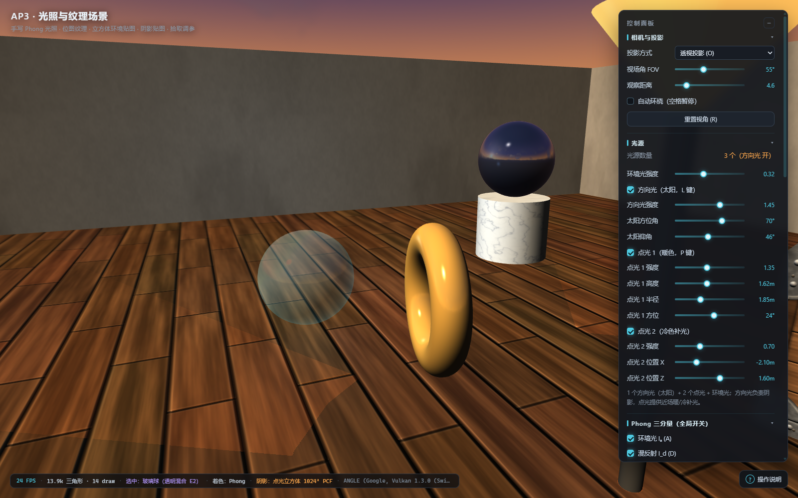

### E3 · Blinn–Phong 与 Toon 着色（与原 Phong 三联对比）

面板「着色模型与扩展」可以切换三种模型，`X` 键进入**三联分屏**（同一帧渲染 3 个视口，
每个视口用不同的 `uShadingModel`，各自重算投影宽高比）：

| 模型 | 镜面项 | 特点 |
|---|---|---|
| ① Phong | `pow(max(R·V, 0), n)` | 高光较"紧"，低高光指数时边缘会出现锐利高光断层 |
| ② Blinn–Phong | `pow(max(N·H, 0), n)`，`H = normalize(L+V)` | 半程向量，高光更宽更柔，计算量更小（无需算 R） |
| ③ Toon 卡通 | 漫反射按 `N·L` 量化成 3 级色带；镜面 `step(0.55, spec)` 硬边 | 硬边色阶 + 块状高光，卡通感 |

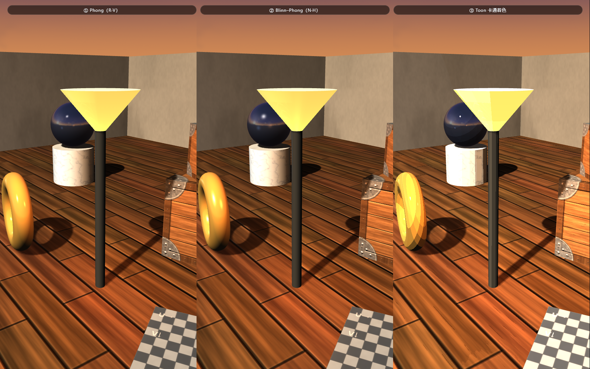

*左 → 右：Phong / Blinn–Phong / Toon。金环与球面上的高光形状差异最明显，Toon 的色阶过渡是硬边。*

---

## 6. 交互说明

**鼠标**

| 操作 | 效果 |
|---|---|
| 左键拖拽 | 环绕旋转视角（轨道相机） |
| 单击（无拖拽） | 颜色编码拾取：选中物体 → 高亮 + 面板切换到该物体材质 |
| 滚轮 | 缩放（对数缩放） |
| 右键拖拽 | 平移环绕中心 |

**键盘**

| 按键 | 功能 | 按键 | 功能 |
|---|---|---|---|
| `1` / `2` / `3` | Phong / Blinn–Phong / Toon | `A` / `D` / `S` | 环境 / 漫反射 / 镜面分量开关 |
| `L` | 方向光开关 | `P` | 点光开关 |
| `H` | 阴影开关 | `N` | 法线贴图开关 |
| `C` | 环境贴图开关 | `T` | 纹理总开关 |
| `X` | 三联分屏对比（E3） | `F` | 线框模式 |
| `O` | 正交 / 透视投影切换 | `R` | 重置视角 |
| `空格` | 暂停 / 继续动画（太阳缓慢移动 + 自动环绕） | `Esc` | 取消选中 |

> 提示：`F` 线框模式用去重后的边索引（`gl.LINES`）绘制，可以清楚看到 13896 个三角形的拓扑；
> `O` 投影切换用 `mat.ortho` 替换 `mat.perspective`，物体位置不变但"近大远小"消失。

| 线框 | 正交投影 | 不加入 bias 的阴影 |
|---|---|---|
| 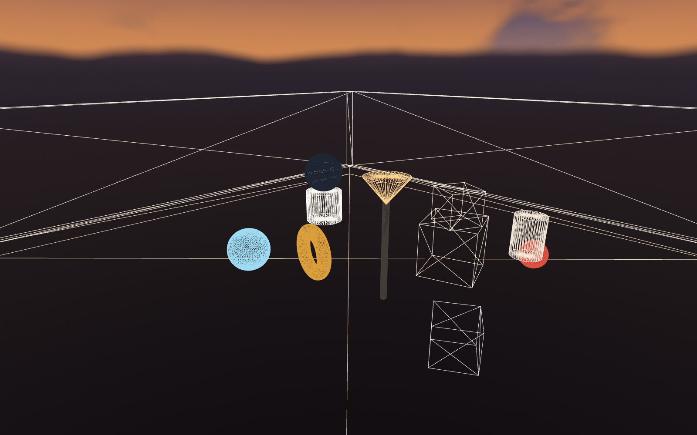 | 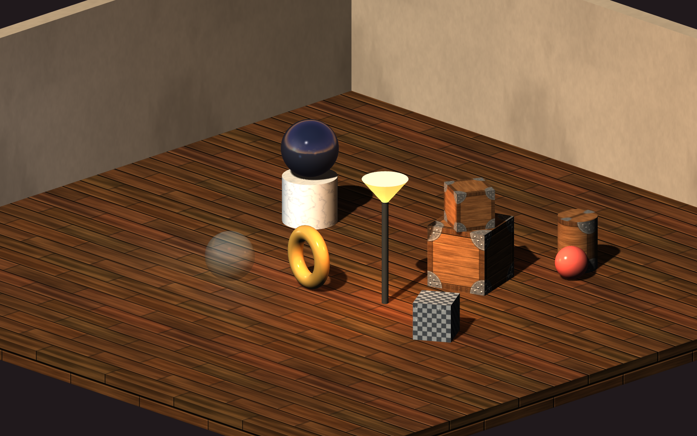 | 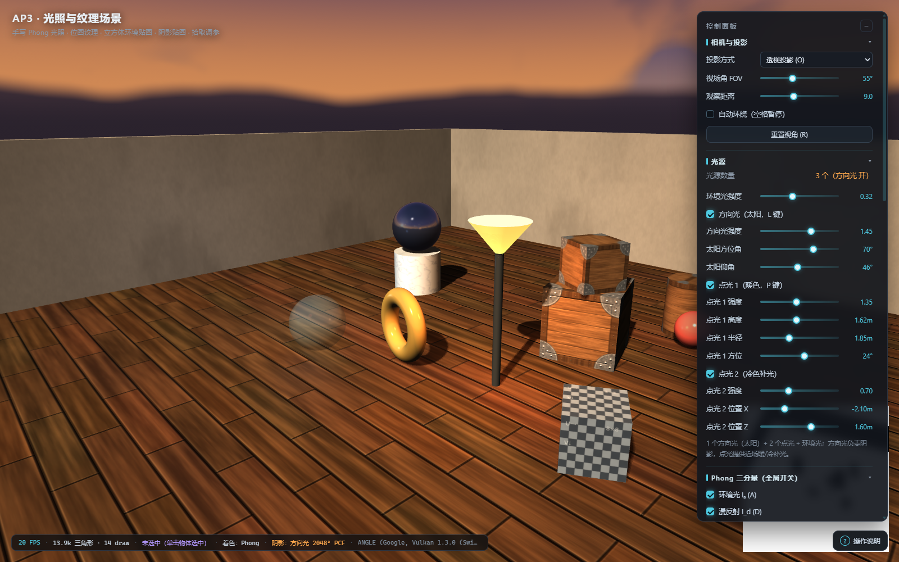 |

---

## 7. 参数面板

面板由 `src/ui-schema.js` **声明式定义**、`src/ui.js` 通用渲染（加参数只需在 schema 里加一行），共 7 组：

1. **相机与投影**：投影方式、FOV、观察距离、自动环绕、重置视角；
2. **光源**：环境光强度、方向光（开关 / 强度 / 方位角 / 仰角）、点光 1（开关 / 强度 / 高度 / 半径 / 方位）、
   点光 2（开关 / 强度 / 位置 X / 位置 Z）；
3. **Phong 三分量（全局开关）**：A/D/S 三个勾选框 + 三个倍率滑条；
4. **选中物体材质**（随拾取动态切换）：kₐ、k_d 颜色、kₛ、高光指数 n、环境反射强度、不透明度；
5. **纹理与环境贴图**：各贴图开关、法线贴图开关与强度、环境反射倍率、天空盒、纹理调制；
6. **阴影贴图**：开关、光源类型、分辨率、正交视锥、bias、PCF、采样半径、深度图小窗、调试可视化；
7. **着色模型与扩展**：三种着色模型、三联分屏、线框、光源辅助、拾取 ID 调试、保存截图、恢复默认。

底部状态栏实时显示：FPS、三角形数 / draw call 数、当前选中物体、着色模型、阴影配置、GPU 名称。

---

## 8. 自测与验证

### 8.1 功能自测（`tools/smoke.mjs`，无头浏览器 + 像素统计，12/12 通过）

| # | 检查项 | 结果 |
|---|---|---|
| 1 | 页面就绪 / 场景三角形 | PASS：13896 三角形，canvas 1570×905，无错误框 |
| 2 | 面板由 schema 生成 / HUD 文本 | PASS：7 组、58 个控件、6 个 HUD 字段 |
| 3 | 方向光阴影贴图生效 | PASS：阴影因子图里 3.4% 片元处于阴影；开关阴影画面最大差 195 |
| 4 | 点光源立方体阴影生效 | PASS：点阴影因子图里 74.0% 片元处于点光阴影 |
| 5 | 阴影贴图分辨率切换（FBO 重建） | PASS：1024² vs 4096² 画面有差异 |
| 6 | 颜色编码拾取 | PASS：网格点击命中 13 个不同物体（含板条箱） |
| 7 | 法线贴图对比（E1） | PASS：开/关特写画面 19.5% 像素变化 |
| 8 | 三种着色模型两两不同 | PASS：Phong↔Blinn 最大差 49.3；↔Toon 平均差 18.3 |
| 9 | 透明混合生效 | PASS：不透明度 0.30 vs 1.0 画面差 2.81 |
| 10 | 键盘快捷键 | PASS：1/2/3、A、H、X、空格、O 全部改到 state |
| 11 | 面板控件点击写入 state | PASS：勾选框 → `state.phong.ambient` 翻转 |
| 12 | 截图 API | PASS：返回 `data:image/png;base64,` |

### 8.2 单元测试

- `node tools/test-geometry.mjs` —— 191 项断言全过：数组长度自洽、索引不越界、法线/切线单位长度且正交、
  UV ∈ [0,1]、三角形绕序 CCW（闭包几何体 ≥99% 通过）、包围盒尺寸正确；
- `node tools/test-mv.mjs` —— 96 项断言全过：MV.js 的矩阵乘法顺序、perspective/ortho/lookAt 与手算值对比、
  normalMatrix 对纯旋转等于自身等。

### 8.3 性能

测试环境为**无头 Edge + SwiftShader 软件渲染**（没有可用 GPU），因此 FPS 只有 20–30；
在真实 GPU 上：场景约 **13.9k 三角形、每帧 14 个 draw call**、阴影贴图 2048²、点光阴影 6×1024²，
主流独立显卡可轻松保持 60 FPS。面板里可以在 1024²/2048²/4096² 之间切换阴影分辨率观察性能与画质权衡。

---

## 9. 关键代码速览（抽问准备）

### 9.1 模型矩阵为什么用 MV.js，而相机/投影用 mat.js？

- **模型矩阵**（`src/scene.js` → `buildModelMatrix`）用教材 `MV.js` 手工组合：
  `M = T · Rz · Ry · Rx · S`，即"先缩放，再依次绕 X/Y/Z 旋转，最后平移"。
  代码里从右往左乘，正好体现教材 Ch4"变换顺序决定结果"：
  ```js
  let m = MV.scale(scale[0], scale[1], scale[2]);                 // S
  if (rotation[2]) m = MV.mult(MV.rotate(rotation[2], [0,0,1]), m); // Rz
  if (rotation[1]) m = MV.mult(MV.rotate(rotation[1], [0,1,0]), m); // Ry
  if (rotation[0]) m = MV.mult(MV.rotate(rotation[0], [1,0,0]), m); // Rx
  m = MV.mult(MV.translate(position[0], position[1], position[2]), m); // T
  ```
- **相机 / 投影 / 逆矩阵**（`src/mat.js`）是引擎内部计算：天空盒需要 `inverse(viewProj)`、
  阴影需要正交投影与光源视图矩阵，这些在渲染循环里每帧调用，集中实现避免类型转换与顺手性错误。
  两者都在用，且职责清晰。

### 9.2 一帧里都发生了什么？

`src/renderer.js → renderFrame()`：

1. **Pass 1 阴影**：`src/shadow.js` 把场景按光源视角渲染到深度 FBO（方向光）或 6 面立方体深度（点光）；
2. **Pass 2 天空盒**：全屏三角形，用 `inverse(viewProj)` 反算每个像素方向，采样 cubemap（`z = 1` 贴在远平面）；
3. **Pass 3 不透明物体**：手写 Phong + 纹理 + 法线贴图 + 环境反射 + 阴影比较；
4. **Pass 4 选中描边**：沿法线外扩 + 剔除正面；
5. **Pass 5 透明物体**：blend 混合、由远到近、不写深度；
6. **Pass 6 调试/显示**：光源辅助球、阴影深度图小窗、拾取 ID 调试、三联/双联分屏；
7. 每帧结束时恢复 WebGL 状态，指针拾取在点击时按需触发一次 ID 渲染 + `readPixels`。

### 9.3 颜色编码拾取的编码方式

```js
// 写入（每个物体画成自己的 ID 颜色）
const r = id & 0xff, g = (id >> 8) & 0xff, b = (id >> 16) & 0xff;
gl.uniform3f(uPickColor, r / 255, g / 255, b / 255);

// 读取（readPixels 读回 1 个像素后反解）
id = px[0] + px[1] * 256 + px[2] * 65536;   // 0 = 没点到任何物体
```
注意 `readPixels` 的原点在**左下角**，所以点击坐标要翻转 y；还要乘上 `canvas.width/clientWidth` 处理设备像素比。

### 9.4 阴影的 bias 是什么？

深度纹理分辨率有限、且斜面在光源空间会被"量化"成阶梯，直接用 `currentDepth > storedDepth` 判断会因为
浮点误差把自己的表面判成阴影（阴影粉刺，见 07 截图）。`bias` 给比较加一个正偏移：
`current = proj.z - bias`，斜率越大偏得越多（`1 - dot(N,L)`）。

---

## 10. 部署到公网 URL

本项目已部署到 **GitHub Pages**，任意电脑浏览器可直接打开：

- **在线场景**：<https://x1nghe159.github.io/AP3/>
- **源码仓库**：<https://github.com/X1ngHe159/AP3>
- **部署方式**：仓库 `main` 分支根目录 → *Settings → Pages → Deploy from a branch → `main` / `/ (root)`*；
- **线上验证**：`node tools/verify-pages.mjs` 用无头 Edge 打开公网地址，检查 `window.__AP3_READY__`、
  console 错误、4xx/5xx 请求与画面像素多样性，结果为 **PASS**（线上截图见下）。

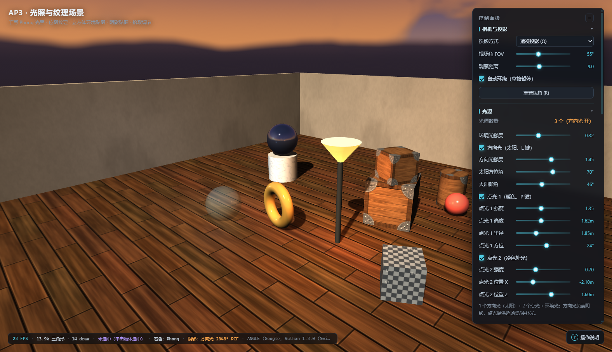

自己重新部署的步骤（换账号 / 换仓库时）：

1. 在 GitHub 新建仓库，把本项目**根目录**下的所有文件推上去
   （`index.html` 必须在仓库根目录，`assets/`、`src/`、`lib/` 保持相对路径不变）；
2. 仓库 → **Settings → Pages** → Source 选 `Deploy from a branch`，Branch 选 `main` / 根目录 `/ (root)`，保存；
3. 等待 1 分钟左右，访问 `https://<用户名>.github.io/<仓库名>/` 即可。

> 注意：**不要**用 `file://` 直接打开（见第 1 节说明）；也不需要 Node 服务器——GitHub Pages 本身就是静态托管。
> 其他等价方案：Gitee Pages、Vercel、Netlify、学校课程平台的静态目录。

---

## 11. 已知限制

1. **阴影只处理方向光与点光 1**：点光 2 不投影阴影（避免每帧 12 次深度 Pass，性能考虑）；
2. **环境贴图反射是"屏幕无关"的近似**：直接用反射方向采样 cubemap，不做平面反射 / 折射；
3. **透明物体不做深度排序的精确解**：只按物体中心到相机距离排序，同一物体自身的前后表面仍可能有排序瑕疵
   （玻璃球是凸体，实际表现良好）；
4. **PCF 是 3×3 固定核**（半径为面板可调），没有做 PCSS 软阴影；
5. **线段框模式**用去重边索引绘制，粗线宽在部分平台不支持（WebGL 线宽通常恒为 1）。

---

## 12. 引用与致谢

- **教材配套工具库**：`lib/webgl-utils.js`、`lib/initShaders.js`、`lib/MV.js` 为
  *Interactive Computer Graphics, 8th ed.* 配套 `Common/` 工具库风格实现，本项目直接沿用，未做破坏性修改；
- **几何体、场景、着色器、渲染管线、面板引擎**：本项目自行编写；
- **全部贴图 / 立方体贴图 / 原理示意图**：由 `tools/make_textures.py`、`tools/make_diagrams.py`
  用 Python（Pillow + numpy）**程序化生成**，不含任何第三方素材（无网络下载、无版权图片）；
- 开发过程中使用了 AI 编程助手辅助整理代码结构与文档文字，所有实现均经过本地无头浏览器逐帧验证
  （截图与自测脚本见 `tools/`），最终代码与设计可由作者逐段讲解。
- 参考：Angel & Shreiner, *Interactive Computer Graphics*, 8th ed.,
  Ch3.9（拾取）、Ch4（变换）、Ch5（观察与投影）、Ch6（光照）、Ch7（纹理与反射）、Ch8.8（阴影）。
